# predecoding call graph

Internal call graph of the production code in `decode.go` and `mapping.go`.
Edges point from caller to callee. Calls to the standard library and to
`zkc` (`bit.NewArray`, `maps.Copy`, `binary`, `elf`) are not drawn.

```mermaid
flowchart TD
    classDef done fill:#c8e6c9,stroke:#2e7d32,color:#1b5e20;

    subgraph API["Public entry points"]
        PrepareInputs
        Predecode
        Load
        NewData
        EncodeInputsMapping["EncodeInputs (mapping)"]
        DecodedEncodeInputs["DecodedProgram.EncodeInputs"]
    end

    subgraph DECODE["decode.go"]
        prepareInputs
        applyOptions
        predecode
        executableBlobs
        executableSpanEnd
        executableSpan
        executableImage
        decodeImage
        decodeInstruction
        extractFields
        instructionTypeFromOpcode
        classifyInstruction
        checkNoOp
        unifiedOperands
        writeBits["bitWriter.writeBits"]
        decodeITypeSemantic
        decodeRTypeSemantic
        decodeSTypeSemantic
        decodeBTypeSemantic
        decodeJTypeSemantic
        decodeUTypeSemantic
        imm12Funct6
        imm12Funct7
        imm12Uimm6
        imm12Uimm5
        assembleITypeImm
        assembleSTypeImm
        assembleBTypeImm
        assembleJTypeImm
        assembleUTypeImm
        signExtend12
        signExtend13
        signExtend21
        encodeInstructionBase
        encodeDecodedRows
        WithMaxDecodedRecords
        WithIncludeExecutable
        WithSectionsWriter
    end

    subgraph MAPPING["mapping.go"]
        loadableSegments
        segmentEnd
        sectionEnd
        isWithin
        isLoadableSection
        extractBlobs
        sortBlobsByAddress
        readSection
        buildBlob
        applyDataOptions
        rawBlobs
        lengthPrefixedBlobs
        newBlob
        payloadAddress
        lengthPrefix
        suffixedName
        WithName
        WithLengthPrefix
        applyInputOptions
        encodeInputs
        mergeAndSortBlobs
        validateBlobsRanges
        writeSectionsIfRequested
        writeSections
        u32Layout
        addressSpace32
        blobDataSize
        encodeExecutableBits
        encodeEntryAndCount
        encodeBlobTables
        buildInputs
        BitArrayFromBytes
    end

    %% Predecoding pipeline
    PrepareInputs --> prepareInputs
    prepareInputs --> applyOptions
    prepareInputs --> Load
    prepareInputs --> predecode
    prepareInputs --> NewData
    prepareInputs --> encodeInputs
    prepareInputs --> DecodedEncodeInputs
    Predecode --> applyOptions
    Predecode --> predecode
    predecode --> executableImage
    predecode --> decodeImage

    %% Executable image
    executableImage --> executableBlobs
    executableImage --> executableSpanEnd
    executableImage --> executableSpan
    decodeImage --> decodeInstruction

    %% Instruction decoding
    decodeInstruction --> extractFields
    decodeInstruction --> instructionTypeFromOpcode
    decodeInstruction --> classifyInstruction
    decodeInstruction --> unifiedOperands
    decodeInstruction --> writeBits
    classifyInstruction --> decodeITypeSemantic
    classifyInstruction --> decodeRTypeSemantic
    classifyInstruction --> decodeSTypeSemantic
    classifyInstruction --> decodeBTypeSemantic
    classifyInstruction --> decodeJTypeSemantic
    classifyInstruction --> decodeUTypeSemantic
    classifyInstruction --> checkNoOp
    decodeITypeSemantic --> imm12Funct6
    decodeITypeSemantic --> imm12Funct7
    decodeITypeSemantic --> imm12Uimm6
    decodeITypeSemantic --> imm12Uimm5
    unifiedOperands --> decodeITypeSemantic
    unifiedOperands --> assembleITypeImm
    unifiedOperands --> assembleSTypeImm
    unifiedOperands --> assembleBTypeImm
    unifiedOperands --> assembleJTypeImm
    unifiedOperands --> assembleUTypeImm
    assembleITypeImm --> signExtend12
    assembleSTypeImm --> signExtend12
    assembleBTypeImm --> signExtend13
    assembleJTypeImm --> signExtend21

    %% Decoded program inputs
    DecodedEncodeInputs --> encodeInstructionBase
    DecodedEncodeInputs --> encodeDecodedRows
    encodeInstructionBase --> BitArrayFromBytes

    %% Mapping: ELF to blobs
    Load --> extractBlobs
    extractBlobs --> loadableSegments
    extractBlobs --> segmentEnd
    extractBlobs --> isLoadableSection
    extractBlobs --> sectionEnd
    extractBlobs --> isWithin
    extractBlobs --> readSection
    extractBlobs --> buildBlob
    extractBlobs --> sortBlobsByAddress

    %% Mapping: data blobs
    NewData --> applyDataOptions
    NewData --> rawBlobs
    NewData --> lengthPrefixedBlobs
    lengthPrefixedBlobs --> payloadAddress
    lengthPrefixedBlobs --> newBlob
    lengthPrefixedBlobs --> lengthPrefix
    newBlob --> suffixedName

    %% Mapping: encoding inputs
    EncodeInputsMapping --> applyInputOptions
    EncodeInputsMapping --> encodeInputs
    encodeInputs --> mergeAndSortBlobs
    encodeInputs --> validateBlobsRanges
    encodeInputs --> writeSectionsIfRequested
    encodeInputs --> u32Layout
    encodeInputs --> encodeEntryAndCount
    encodeInputs --> encodeBlobTables
    encodeInputs --> buildInputs
    encodeInputs --> encodeExecutableBits
    encodeInputs --> BitArrayFromBytes
    writeSectionsIfRequested --> writeSections
    u32Layout --> addressSpace32
    u32Layout --> blobDataSize
    buildInputs --> BitArrayFromBytes

    class PrepareInputs,Predecode,Load,NewData,EncodeInputsMapping,DecodedEncodeInputs,prepareInputs,applyOptions,predecode,executableBlobs,executableSpanEnd,executableSpan,executableImage,decodeImage,decodeInstruction,extractFields,instructionTypeFromOpcode,classifyInstruction,checkNoOp,unifiedOperands,writeBits,decodeITypeSemantic,decodeRTypeSemantic,decodeSTypeSemantic,decodeBTypeSemantic,decodeJTypeSemantic,decodeUTypeSemantic,imm12Funct6,imm12Funct7,imm12Uimm6,imm12Uimm5,assembleITypeImm,assembleSTypeImm,assembleBTypeImm,assembleJTypeImm,assembleUTypeImm,signExtend12,signExtend13,signExtend21,encodeInstructionBase,encodeDecodedRows,WithMaxDecodedRecords,WithIncludeExecutable,WithSectionsWriter,loadableSegments,segmentEnd,sectionEnd,isWithin,isLoadableSection,extractBlobs,sortBlobsByAddress,readSection,buildBlob,applyDataOptions,rawBlobs,lengthPrefixedBlobs,newBlob,payloadAddress,lengthPrefix,suffixedName,WithName,WithLengthPrefix,applyInputOptions,encodeInputs,mergeAndSortBlobs,validateBlobsRanges,writeSectionsIfRequested,writeSections,u32Layout,addressSpace32,blobDataSize,encodeExecutableBits,encodeEntryAndCount,encodeBlobTables,buildInputs,BitArrayFromBytes done
```

