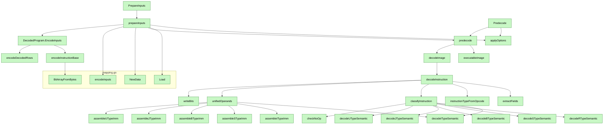
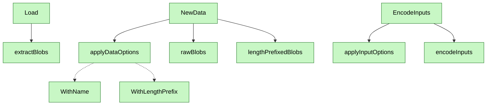

# Predecoding call graph

Overview of how the production code of this package fits together.

It is a simplified map, not a complete call graph (small helpers are  
left out so that the main flow stays readable), to help see the entry points

of the predecoding script. Edges point from caller to  
callee. Calls to the standard library and to `zkc` are not drawn.

## decode.go

Turns a loaded program into the `instruction_base` and `decoded` inputs.

- `PrepareInputs` is the one-call entry point: it loads the ELF, predecodes it,
maps the input data and encodes all the inputs.
- `Predecode` is the predecoding step alone. `executableImage` lays the
executable blobs out as one byte image, and `decodeImage` emits one record
per four-byte word of that image.
- `decodeInstruction` builds one record: `classifyInstruction` gives the compute
op, `unifiedOperands` the immediate and the registers, and `writeBits` packs
them.

The box groups the `mapping.go` functions called from here; their own calls are
in the second diagram. Not drawn: the options (`WithMaxDecodedRecords`,
`WithIncludeExecutable`, `WithSectionsWriter`) and the helpers called by
`executableImage`, `decodeITypeSemantic` and the `assemble...` functions.

## mapping.go

Turns an ELF and the guest input data into memory blobs, then into the mapping
inputs.

- `Load` reads the loadable sections of the ELF into blobs.
- `NewData` maps the input data as blobs. The dotted edges are its options.
- `EncodeInputs` encodes a program and additional blobs into the inputs.

Not drawn: the helpers called by `extractBlobs`, `lengthPrefixedBlobs` and
`encodeInputs`.

